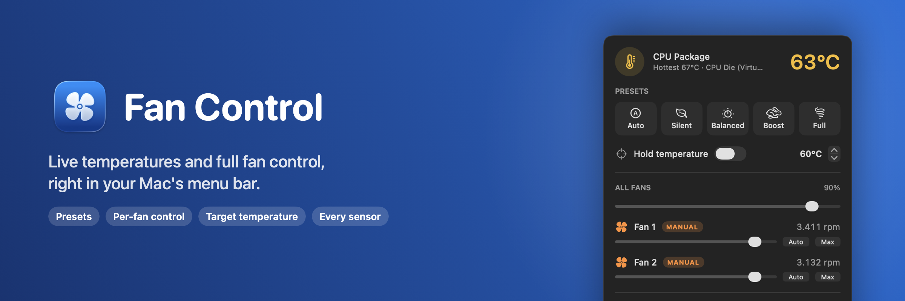
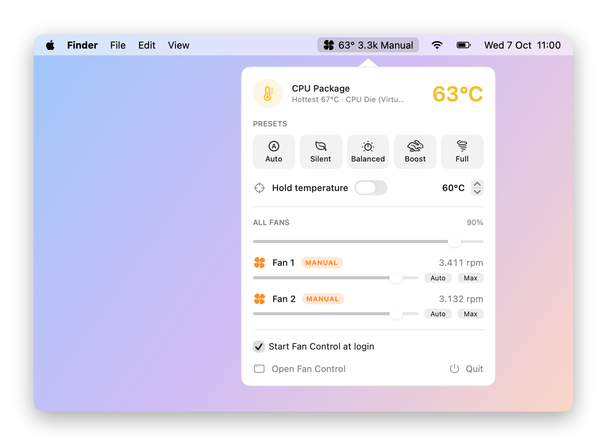
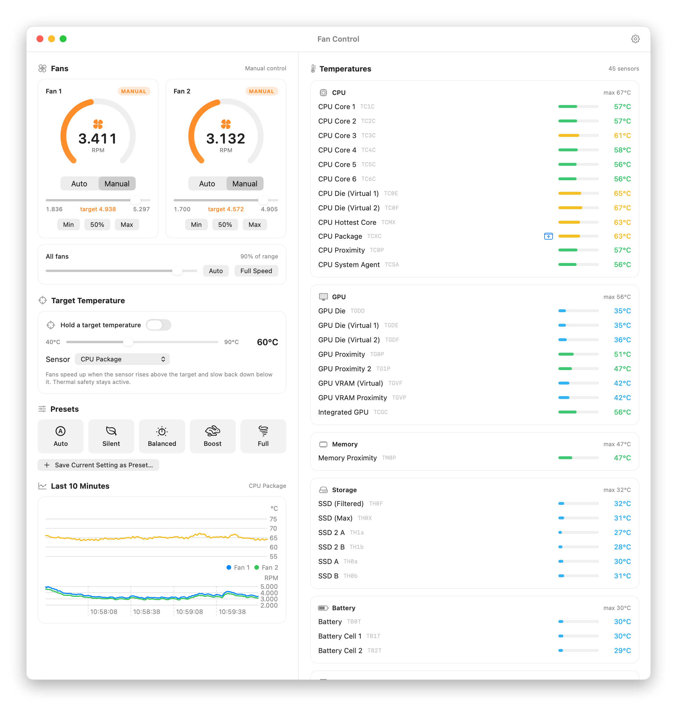
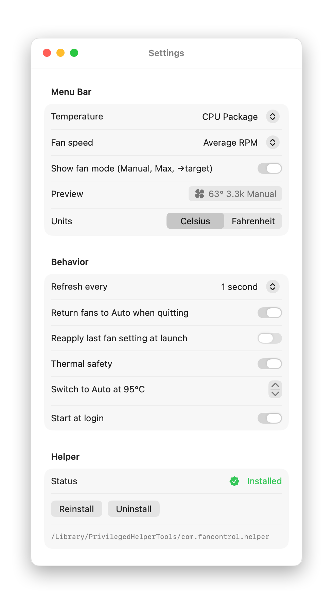

<p align="center">
  
</p>

<p align="center">
  
  
  
  
  
  
  
</p>

**Fan Control** is a macOS menu bar app for Intel MacBooks. It shows the live temperature and fan speed in your menu bar. You can control the fans one at a time or together, use presets from silent to full speed, or let the app hold a target temperature.

## Contents

- [Screenshots](#screenshots)
- [Features](#features)
- [Install](#install)
- [The helper](#the-helper-why-the-admin-prompt)
- [Safety](#safety)
- [Development](#development)
- [License](#license)

## Screenshots

**Menu bar & popover:** the temperature and fan speed are always visible, and one click gives you every control.

<picture>
  <source media="(prefers-color-scheme: dark)" srcset="docs/images/popover-dark.png">
  
</picture>

**Main window:** every fan and every temperature sensor (45 on a 16" MacBook Pro), with target temperature and presets.

<picture>
  <source media="(prefers-color-scheme: dark)" srcset="docs/images/window-dark.png">
  
</picture>

<details>
<summary><b>Settings</b></summary>
<br>
<picture>
  <source media="(prefers-color-scheme: dark)" srcset="docs/images/settings-dark.png">
  
</picture>
</details>

## Features

**Menu bar**
- A fan icon plus the live temperature and fan status, e.g. `56° 1.8k` or `64° 3.4k →60°`.
- Fan speed can be shown as average RPM, RPM per fan, or percent of max, or hidden.
- The icon fills in, and a label (`Manual`, `Max`, `→60°`) appears, whenever macOS isn't controlling the fans.
- **Left-click** opens the popover with presets, target temperature, an all-fans slider, per-fan sliders, and Auto/Max buttons.
- **Right-click** opens a quick menu with the presets, *Hold 60 °C*, display options, Start at Login, Open and Quit.

**Window**
- Every fan with a live gauge, an Auto/Manual switch, a slider, and Min/50%/Max buttons, plus an all-fans slider with **Auto** and **Full Speed**.
- **Target temperature:** pick a temperature (40–90 °C, default 60 °C) and a sensor (default CPU Package). The app adjusts all fans continuously to hold it. It ramps up quickly when the sensor goes over the target and slows down gently below it. Touching any preset or slider turns it off.
- **Presets:** *Auto, Silent, Balanced, Boost, Full*, plus your own. Use *Save Current Setting as Preset…* to add one, and right-click a custom preset to delete it.
- Every temperature sensor, grouped (CPU, GPU, memory, storage, battery, mainboard, airflow, enclosure). Hover a sensor and click the pin to show it in the menu bar.
- A 10-minute history of temperature and fan speed.

**Settings** (gear icon)
- Menu bar sensor and fan-speed display (with a live preview), °C/°F, and refresh rate.
- Return to Auto on quit, reapply the last setting at launch, and thermal safety.
- **Start at login:** registers the app under System Settings → General → Login Items. Combine it with *Reapply last fan setting at launch* to get your fan mode (including target temperature) back after a restart.
- Helper install, reinstall and uninstall.

## Install

Requires an Intel Mac with macOS 14 or later, and the Xcode Command Line Tools (`xcode-select --install`). Full Xcode isn't needed.

```bash
git clone git@github.com:winfried-van-loon/fan-control.git
cd fan-control
./build.sh --install
```

This builds `build/Fan Control.app` and copies it to `/Applications`. If the app is already running, it quits it cleanly (fans go back to Auto) and reopens it. Run `./build.sh` without `--install` to only build.

Then click the fan icon in the menu bar and choose **Install** to set up the helper.

## The helper (why the admin prompt)

Reading temperatures and fan speeds needs no special rights. **Changing fan speeds requires root**, because the SMC rejects writes from normal processes.

The first time, click **Install** in the app. macOS asks for your admin password once. The app then installs a tiny setuid-root helper at `/Library/PrivilegedHelperTools/com.fancontrol.helper`.

The helper only understands three commands:

```
fanhelper version
fanhelper set  <fan|all> <rpm>   # forced mode; rpm is clamped to the fan's own min…max
fanhelper auto <fan|all>         # hand the fan back to macOS
```

Because it's setuid, any local user account on this Mac can run it, but only to set fan speeds within Apple's min/max range. You can remove it under Settings → Helper → Uninstall.

## Safety

- Speeds are always clamped to the fan's own SMC minimum/maximum.
- **Return fans to Auto when quitting** is on by default. This also applies when the app is stopped with `kill`/`pkill`.
- **Thermal safety** is on by default: if any CPU/GPU sensor reaches 95 °C while fans are manually set below maximum, the app returns them to Auto.
- Target mode can only raise fans to their maximum. If the load is too high to reach the target, the fans stay at 100%, and thermal safety still applies.
- If macOS takes a fan back (e.g. after sleep), the app reapplies your setting.

## Development

```
Sources/CSMC        C bridge to AppleSMC (IOKit)
Sources/FanKit      SMC value decoding, sensor catalog, fan read/write
Sources/FanHelper   the privileged CLI helper
Sources/FanControl  the menu bar app (AppKit status item + SwiftUI views)
Sources/smcprobe    dev tool: dumps all fan & temperature SMC keys
scripts/            app icon generator
docs/images/        README images
```

To regenerate the README images, run the command below. It uses live sensor data, waits 2.5 minutes to fill the history chart, and never writes to the fans or your settings.

```bash
"build/Fan Control.app/Contents/MacOS/FanControl" --screenshots docs/images
```

Built and tested on a MacBookPro16,1 (Intel, T2) running macOS 26. Fan control uses the T2-era `F<n>Md` / `F<n>Tg` keys. Apple Silicon Macs use different keys and are not supported for writing yet, although temperature reading may partially work there.

## License

[GPL-3.0](LICENSE)
